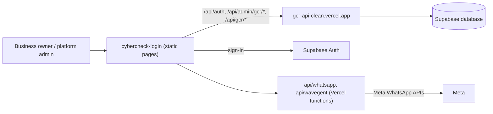

# cybercheck-login

The business-owner login and admin console front end for the CyberCheck / Gulf Coast Radar (GCR) platform.

## What it is

A large set of static web pages (no build step). A business owner signs in, edits their listing (info, hours, photos, menus, events, specials) and uses booking and app tools; a platform admin manages every GCR listing from one big page. Despite the name it is much more than a login page. It holds no database code of its own: the pages call the hosted `gcr-api-clean` API.

## How it works

- `login.html` sets `window.CC_API_BASE = 'https://gcr-api-clean.vercel.app'`, signs in through Supabase Auth (`js/supabase-client.js`) and keeps the session token in `localStorage` as `cc_token`. Always enter through `login.html`; `admin.html` redirects back if no token is present.
- `admin.html` - a single-page console with panels swapped by `showPage()`: businesses, entity editor, site sections, claims, events, specials, ads, SEO, bulk CSV upload, AI chat. It calls `/api/admin/gcr/entities/...`, `/api/admin/gcr/sections/...`, `/api/admin/gcr/upload-image`, `/api/admin/gcr/business-data/...` and `/api/gcr/entity/...` on the API above.
- Other pages: `admin-dashboard.html`, `app-dashboard.html`, `app-store.html`, `booking.html`, `book.html`, `biz.html`, `card-builder.html`, `claim-business.html`, `menu-editor*.html`, `onboarding*.html`, `song-request.html`, `waiver.html`, `signup.html`. Supporting folders: `js/`, `css/`, `apps/` (69 app definitions as JSON), `integrations/`, `tabs/`, `tools/` (check scripts).
- `vercel.json` - static site with rewrites: `/p/:slug` to `biz.html`, `/book/:slug/:app`, `/waiver/:slug`, `/manage/:id`, `/live/:slug`, `/daily/:slug`, `/q/:code`, `/widget/:slug`, `/wavegent/:slug`.
- `api/wavegent/[slug].js` and `api/whatsapp/{send,status,disconnect,exchange-token}.js` - the only server code, as Vercel functions.
- `migrations/` - two SQL files only (`blackout-dates.sql`, `whatsapp-business.sql`); there is no full schema here.

## Run it

No install. Serve the folder with any static server and open `login.html`:

```bash
npx serve .
# or
python3 -m http.server 8080
```

Sign-in and data only work against the deployed API and Supabase project, which are not in this repo. The Vercel functions under `api/` need these environment variable names: `SUPABASE_URL`, `SUPABASE_SERVICE_KEY`, `META_APP_ID`, `META_APP_SECRET`.

## Status

**In use.** The current admin/login front end (single commit on `main`, 2026-08-02), wired to `gcr-api-clean`.

## Where it fits



## Related repos

- `gcr-api-clean` - the API this front end talks to; the only thing that talks to the database.
- `gcr-admin` - older copy of this console (about 170 identical files) pointed at the previous API; superseded by this repo.
- `live-gcr` - early backend-plus-admin bundle sharing some admin files.
- `gcr-public` - the public customer site that reads from the same platform family.
